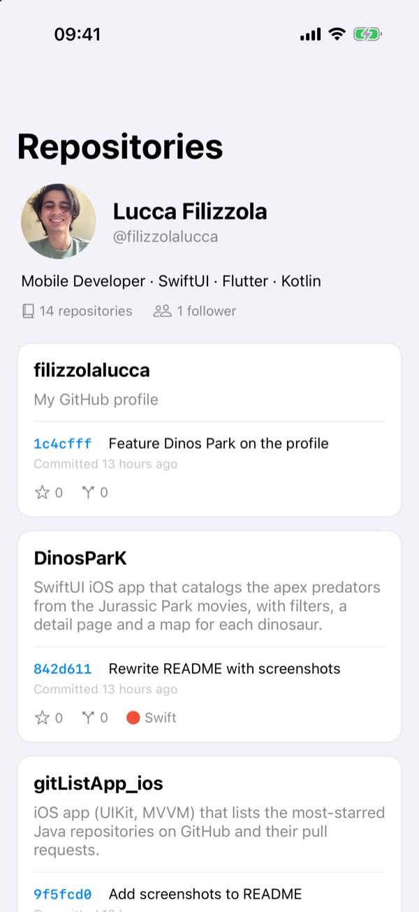
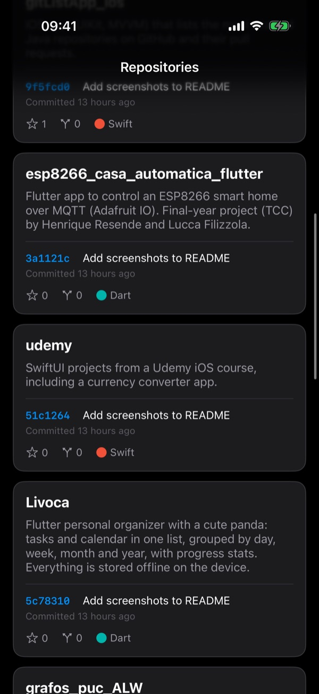
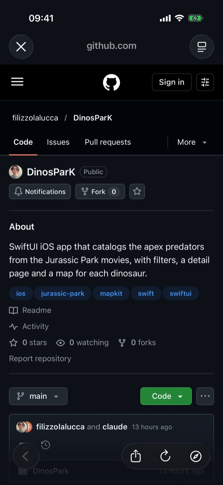

<h1 align="center">Repo Explorer</h1>

  A UIKit app that shows a GitHub profile and its repositories, loading the latest commit of each one as you scroll. Built entirely in view code, with MVVM, async/await and no third-party libraries.

  
  
  
  

  
  &nbsp;
  
  &nbsp;
  

## Features

- **Profile header** with avatar, name, bio and repository and follower counts
- **Repository cards** with description, stars, forks and a language color dot, most recently updated first
- **Latest commit** per repository (short SHA, message and relative date), loaded on demand as cells appear
- **Skeleton loading** with an animated shimmer, for the whole card and then just the commit line
- **Pull to refresh**, and tap a card to open the repository in Safari
- **Tap to retry** when a commit fails to load
- **Dark mode** support, including layer colors
- Clear error messages, including GitHub's rate limit

## Running

Open `RepoExplorer.xcodeproj` in Xcode and run on an iOS 15.6+ simulator or device. No setup, no dependencies.

To show a different account, change `GitHubConfig.username`.

## Architecture

MVVM, with the whole UI built in view code (no storyboards). `Main.storyboard` is gone and the window and root controller are set up manually in `SceneDelegate`. The default `LaunchScreen` stays, since it's just the splash and has no logic.

The project is split by responsibility:

* `Core/Networking`: the network client, one service per endpoint and an image loader.
* `Core/Models`: the decodable models (`Repository`, `Commit`, `UserProfile`).
* `Core/Extensions`: small UIKit helpers (see below).
* `Home`: the screen, its view model and the custom cells.

### Networking

`URLSession` with async/await, no third-party libraries. A generic `NetworkClient` does the request, checks the status code and decodes the response, and each endpoint has its own service on top of it (`RepositoryService`, `CommitService`, `UserService`). This keeps transport and decoding in one place instead of duplicating them in every service. Each service has its own protocol, so the view model depends on abstractions and stays testable.

The models are `Decodable` only, since the app just reads from the API. Decoding uses `convertFromSnakeCase` and ISO 8601 dates, so there are no hand-written `CodingKeys`. `description` and `language` are optional on purpose, because many repositories don't have them.

Errors are typed (`NetworkError`) and carry the status code, so the app can tell the user when GitHub's rate limit was hit, and treat the `409` GitHub returns for empty repositories as "no commits" instead of a failure.

### State and binding

The view model exposes its state through closure callbacks (`onStateChange` and `onCommitLoaded`) instead of a reactive framework. Since the networking is already async/await and this is a single screen, a lightweight closure binding is more proportional than pulling in a second async paradigm like RxSwift or Combine.

The callbacks are split by granularity: `onStateChange` reloads the whole table (loading, loaded, error), while `onCommitLoaded` reloads just the affected row with a fade, so the other cells don't flicker when a commit arrives.

Every reload bumps a generation counter, so responses that arrive after a pull to refresh are ignored instead of landing on the wrong row.

## Two-step loading

The profile and the repository list load first, in parallel, and show right away, with each commit line still in a loading state. Then each commit loads separately, so the list stays scrollable while data comes in.

Commits are fetched on demand from `willDisplay`, so the app only hits the API for cells the user actually sees, and asks GitHub for a single commit per repository. A `Set` tracks which repositories were already requested, so scrolling back and forth doesn't fire duplicate calls. Each commit ends up loaded, empty or failed, and the cell renders each state accordingly.

## Custom UI

Each cell is a card with rounded corners showing the name, description, the latest commit and a footer with stars, forks and language, with a small press animation.

While the list loads, each card shows a skeleton made of animated shimmer bars. Once it's loaded, only the commit line keeps shimmering until its data arrives. The shimmer is a reusable `ShimmerView` built with a `CAGradientLayer` and an animated sweep.

The cell swaps the skeleton and content stacks in and out on configure instead of overlaying them. Keeping both in place and toggling visibility let the fixed-width shimmer bars constrain the multiline labels, wrapping the description too early. Swapping them avoids that conflict, at a negligible cost for this list size.

## Helpers

To keep the view code concise without a layout library, there are a few small helpers: `addSubviewContained`, which pins a view to its parent's edges (with padding or per-edge insets, and an optional safe area flag), convenience inits for `UIStackView`, `UILabel` and `ShimmerView`, an SF Symbol + text attributed string builder and GitHub's language colors. They replace what SnapKit would usually provide.

## On authentication

The GitHub API allows 60 unauthenticated requests per hour. Auth is intentionally left out: embedding a token in the app would expose a credential. On-demand commit loading keeps the request count low enough to stay within the limit during normal use.

## Next steps

* Unit tests for the networking and decoding layers, using the service protocols to inject mocks.
* Pagination for accounts with more than 100 repositories.

## Author

**Lucca Filizzola** · [@filizzolalucca](https://github.com/filizzolalucca)
